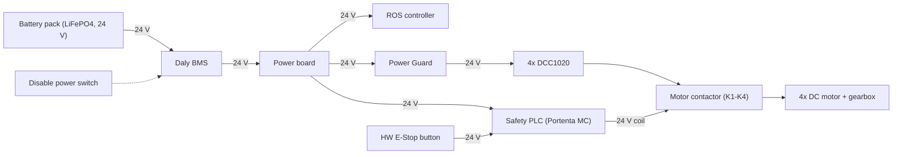
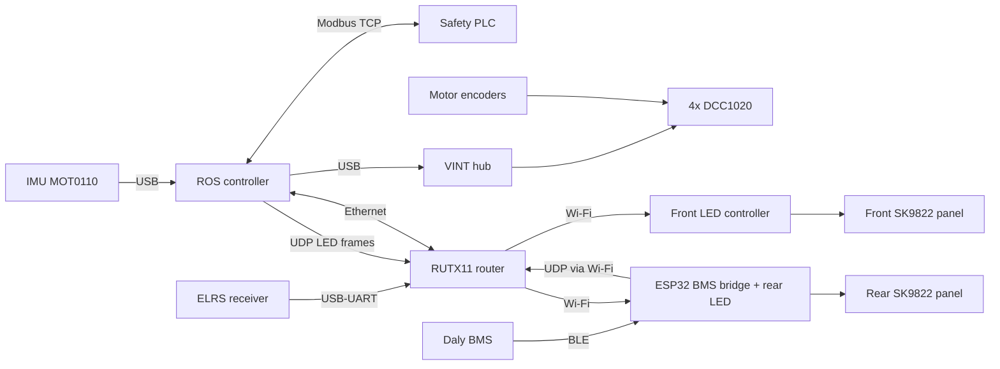

# Components

This page lists the main hardware blocks of the Ardennes platform, how they connect, and where their datasheets are. For dimensions and performance figures see [Specification](specification.md).

## Component list

| # | Component | Model / part | Role | Interface / link |
|---|-----------|--------------|------|------------------|
| 1 | ROS controller | **TBD** (labelled `RPi` in the architecture diagram) | Runs the isaacbot ROS 2 stack, `controller_manager` and all platform nodes | Ethernet to the safety PLC, Ethernet to the router, Wi-Fi, USB |
| 2 | Safety PLC | Arduino Portenta Machine Control | Holds the E-Stop latch, drives the motor contactor, runs the CPU watchdog, exposes 12 aux IO points | Modbus TCP, `192.168.88.11:502` |
| 3 | Motor contactor | **TBD** (drawn as relays K1–K4, one per motor) | Disconnects the motors from the drivers on an E-Stop. Its auxiliary contact is read back by the PLC | Coil driven by the PLC (24 V); feedback on `COIL_0` |
| 4 | Hardware E-Stop button | **TBD** (`PB1` / `E_BTN` in the diagram) | Trips the PLC latch | 24 V input to the PLC (`IX 0.0`), read as `CONTACT_0` |
| 5 | Motor controllers (4×) | Phidget DCC1020 ("30V 50A DC Motor Phidget", SKU DCC1020_0), one brushed motor per board | DC motor drive, x4 quadrature encoder input, on-board speed loop (trapezoidal profile + PID), current / temperature / supply-voltage sensing, failsafe watchdog, hardware E-Stop input | VINT hub ports 0, 1, 4, 5 (Phidget22 SDK, libphidget22 ≥ 1.26) |
| 6 | VINT hub | **TBD** | Connects the four DCC1020 boards to the ROS controller (the DCC1020 needs a VINT hub) | USB |
| 7 | Drive motors (4×) | DOBTIAN "250W 24V 120RPM Low Speed Brush Motor" (brushed DC gear motor, 250 W, 24 V, 120 RPM at the output shaft; see the note below the wheel table for the model identifiers), with an MT6835 magnetic encoder | Wheel drive, one per wheel | Motor leads and encoder to its DCC1020 |
| 8 | IMU | Phidgets Spatial MOT0110 | Orientation, angular velocity, linear acceleration (Madgwick filter, magnetometer off) | USB |
| 9 | Battery management system | Daly BMS (model **TBD**) | Cell monitoring, protection, telemetry | BLE to the ESP32 bridge |
| 10 | BMS bridge / rear LED controller | ESP32, firmware `isaacbot_amr_led_bms_ble_controller` | Polls the BMS over BLE and forwards it over UDP. Also drives the rear LED panel | Wi-Fi, `192.168.77.201` |
| 11 | Battery pack | LiFePO4, 40 Ah, 24 V system (pack model and nominal voltage **TBD**) | Main power source | Through the BMS to the power board |
| 12 | LED panels (2×) | SK9822, 2 rows × 20 LEDs each | Front and rear bumper status lights | Wired to its LED controller |
| 13 | Front LED controller | **TBD** | Drives the front LED panel | Wi-Fi, UDP `192.168.77.202:3334` |
| 14 | RC receiver | ExpressLRS (CRSF), model **TBD** | Radio teleop and software E-Stop switches | USB-UART adapter on the RUTX11 USB port, 460800 baud; forwarded over UDP to `192.168.1.201:10111` |
| 15 | Router | RUTX11 Wi-Fi / GSM / GPS router | Platform LAN and Wi-Fi access point | Ethernet to the ROS controller, Wi-Fi to the LED/BMS controllers |
| 16 | Power board and Power Guard | **TBD** (Phidgets recommends a Power Guard SAF2000 or SAF2020 in front of the DCC1020) | 24 V distribution. The Power Guard feeds the motor drivers | 24 V |

Sources: `isaacbot_amr_arch/ardennes_arch.drawio`, `isaacbot_amr_safety/README.md`, `isaacbot_amr_msgs/msg/AuxIoState.msg`, `isaacbot_amr_description/urdf/ardennes/ardennes_macro.urdf.xacro`, `isaacbot_amr_arch/SAFETY_CHAIN.md`, `isaacbot_amr_hardware_interface/src/isaacbot_amr_driver/ardennes_driver.cpp`, `isaacbot_amr_hardware_interface/README.md`, `isaacbot_amr_description/urdf/common/imu.urdf.xacro`, `isaacbot_amr_battery/README.md`, `isaacbot_amr_led/config/ardennes_udp_led_channel_2.yaml`, `isaacbot_amr_battery/config/isaacbot_amr_battery.yaml`, `isaacbot_amr_led/README.md`, `isaacbot_amr_led/config/ardennes_driver.yaml`, `isaacbot_amr_led/config/ardennes_udp_led_channel_1.yaml`, `isaacbot_amr_crsf_teleop/config/isaacbot_amr_crsf_teleop.yaml`.

The lidar and GNSS receiver are part of the sensor payload. They are documented in the `isaacbot_amr_sensors` repository, not here.

!!! note "Motor contactor drawing"
    `SAFETY_CHAIN.md` describes one contactor with an auxiliary contact. The electrical schematic in `ardennes_arch.drawio` draws four relays (K1–K4), one in series with each motor, with their coils in parallel on PLC output `QX 0.0`, and does not show the auxiliary contact.

!!! warning "DCC1020 E-Stop input"
    Each DCC1020 has a hardware E-Stop input that is always enabled. The boards ship with a jumper on it, and on the A1 the jumper is still fitted, so the input is not part of the safety chain yet. Wiring it to the chain is an [open item](../open-items.md). When it opens, the board reports `EEPHIDGET_ESTOP` (latched `fault_flag.emergency_stop`).

## Wheels and drivetrain

The A1 is a four-wheel-drive skid-steer platform. Each wheel has its own motor, gearbox, encoder and DCC1020. The ROS side drives it as a differential drive: `diff_drive_controller` writes the wheel velocities, and each DCC1020 closes the speed loop on board.

| Item | Value | Source |
|------|-------|--------|
| Drive layout | 4WD skid-steer, one motor per wheel | `isaacbot_amr_controller/config/wheel_01_controller.yaml` |
| Wheel type | Non-mecanum (`mecanum: False`), CAD part `WHEEL_CHUNK_1000_WATT_VARIANT`; tyre type **TBD** | `isaacbot_amr_description/config/wheel_01.yaml` |
| Tyre radius (CAD) | 0.1699 m | `isaacbot_amr_description/config/wheel_01.yaml` |
| Effective rolling radius (odometry) | 0.1651 m | `isaacbot_amr_description/config/wheel_01.yaml`, `isaacbot_amr_controller/config/wheel_01_controller.yaml` |
| Wheel width | 0.108 m | `isaacbot_amr_description/config/wheel_01.yaml` |
| Gear ratio | 23.3 | `ardennes_macro.urdf.xacro` (`gear_ratio`) |
| Gearbox efficiency | 0.70 | `ardennes_macro.urdf.xacro` (`gearbox_efficiency`) |
| Encoder resolution | 1024 lines per motor revolution (the driver counts 4 edges per line) | `ardennes_macro.urdf.xacro` (`encoder_resolution`), `isaacbot_amr_hardware_interface/src/domain/driver_data_snapshot.cpp`, `phidget_motor_driver.cpp` |
| Max motor speed | 2800 rpm | `ardennes_macro.urdf.xacro` (`max_rpm_motor_speed`) |
| Motor torque constant | 0.11 N·m/A | `ardennes_macro.urdf.xacro` (`motor_torque_constant`) |
| Motor stall current | 16 A at 24 V | comment on `motor_current_limit` in `ardennes_macro.urdf.xacro` |
| DCC1020 rating | 8–30 V supply, 50 A continuous, 75 A peak | Phidgets DCC1020 product page |
| DCC1020 current limit | 15 A (ASSUMPTION carried over from the DCC1000; Phidgets suggests ~1.1× rated ≈ 11.5 A) | `ardennes_macro.urdf.xacro` (`motor_current_limit`) |
| DCC1020 speed loop gains and acceleration | **TBD** (board defaults until tuned; logged at configure) | `ardennes_macro.urdf.xacro` (`velocity_kp/ki/kd`, `motor_acceleration_rpm_s`) |
| DCC1020 failsafe timeout | 500 ms, brake on trip | `ardennes_macro.urdf.xacro` (`motor_failsafe_timeout_ms`, `motor_failsafe_braking_enabled`) |

The tyre radius and the odometry radius differ on purpose. The CAD radius places the model on the ground. The odometry radius is the one the controllers are tuned on.

| Wheel | Joint | VINT hub port | Direction reversed | Source |
|-------|-------|---------------|--------------------|--------|
| Front left | `fl_wheel_base_to_fl_wheel_joint` | 0 | yes | `isaacbot_amr_hardware_interface/src/isaacbot_amr_driver/ardennes_driver.cpp` |
| Front right | `fr_wheel_base_to_fr_wheel_joint` | 1 | no | same |
| Rear left | `rl_wheel_base_to_rl_wheel_joint` | 4 | yes | same |
| Rear right | `rr_wheel_base_to_rr_wheel_joint` | 5 | no | same |

The motors are DOBTIAN 250 W, 24 V, 120 RPM permanent-magnet brushed DC gear motors. From the seller listing (AliExpress, brand Dobtian; copied by the owner, not from a datasheet): "Model Number: 250w low speed brush motor", rated voltage 24 V, rated current 13.4 A, power 250 W, speed options 75 or 120 r/min (the isaacbot has the 120 r/min variant). The owner also gives the identifier 254324557 (source not stated: it is not the listing's model-number field). The listing's gear ratio, stall current, torque, weight, shaft and encoder details are not given. Its "waterproof" claim has no IP rating and is not used. The 120 RPM is the output shaft: the URDF's 2800 rpm motor speed divided by the 23.3 gear ratio is 120.2 rpm, which is 12.58 rad/s at the wheel (the clamp on the motor RPM target). Each motor carries an **MT6835** magnetic encoder (MagnTek/Novosense, 21-bit absolute) on a board powered from 5 V with no regulator. The board's `JP3` header carries +5 V, A, B, Z, U, V, W and GND, and `JP1`/`JP2` carry the SPI lines (CS, CLK, MOSI, MISO) and `HVPP`. The A/B/Z outputs are push-pull at 5 V (from the board schematic, not yet measured). The DCC1020 decodes A/B in x4 quadrature and reports velocity at its own minimum data interval (or `motor_data_interval_ms`). Its encoder input electrical mode against the 5 V push-pull outputs is **TBD** (bench check). The sensor itself is not the limit: its propagation delay is under 10 µs. How the board is wired to the DCC1020 (pins, cable length) is **TBD**. Control loop details are in [Drive and control](../software/drive-and-control.md).

## Block diagram

The diagrams are redrawn from the "Ardennes System Definition" and network pages of `isaacbot_amr_arch/ardennes_arch.drawio`, then checked against the code. Where the two disagree, the diagram follows the code (see the warning below).

### Power

Source: `isaacbot_amr_arch/ardennes_arch.drawio` (System Definition and Electrical Schematic pages). How the LED controllers, the router and the IMU are powered is **TBD**.

### Data

Source: `isaacbot_amr_arch/ardennes_arch.drawio`, `isaacbot_amr_battery/README.md`, `isaacbot_amr_led/README.md`, `isaacbot_amr_crsf_teleop/README.md`, `isaacbot_amr_hardware_interface/README.md`. Addresses and ports are on [IO and network](io-and-network.md).

!!! warning "Source conflict"
    The hardware part of the diagram `isaacbot_amr_arch/ardennes_arch.drawio` still connects the battery monitor to the controller over **RS485/RS232**. The code receives BMS data over **UDP** from the ESP32 bridge, which reads the Daly BMS over BLE (`isaacbot_amr_battery/README.md`, `isaacbot_amr_battery/launch/isaacbot_amr_battery.launch.py`). The software part of the diagram shows `isaacbot_amr_battery` on a UDP socket. This page follows the code.

## Datasheets and protocol documents

| Document | Covers |
|----------|--------|
| [DCC1020 product page](https://www.phidgets.com/?prodid=1333) | Phidget DCC1020 DC motor controller (specs, user guide, API). Not in the repository |
| [DCC1000_reference.pdf](https://github.com/isaacbotsrl/isaacbot_amr_ros/blob/main/isaacbot_amr_hardware_interface/docs/DCC1000_reference.pdf) | Phidget DCC1000 (the previous motor controller; kept for reference) |
| [MOT0110_reference.pdf](https://github.com/isaacbotsrl/isaacbot_amr_ros/blob/main/isaacbot_amr_hardware_interface/docs/MOT0110_reference.pdf) | Phidgets Spatial MOT0110 IMU |
| [Part 3 - Daly CAN Protocol.pdf](https://github.com/isaacbotsrl/isaacbot_amr_ros/blob/main/isaacbot_amr_battery/docs/Part%203%20-%20Daly%20CAN%20Protocol.pdf) | Daly BMS CAN protocol |
| [Part 4 - Daly RS485+UART Protocol.pdf](https://github.com/isaacbotsrl/isaacbot_amr_ros/blob/main/isaacbot_amr_battery/docs/Part%204%20-%20Daly%20RS485%2BUART%20Protocol.pdf) | Daly BMS RS485/UART protocol (data units used by the bridge) |

Datasheets for the Portenta Machine Control, the motors and the MT6835 encoder board, the ELRS receiver, the VINT hub and the router are not in the repository (**TBD**).

Further reading: [isaacbot_amr_hardware_interface README](https://github.com/isaacbotsrl/isaacbot_amr_ros/blob/main/isaacbot_amr_hardware_interface/README.md), [isaacbot_amr_description README](https://github.com/isaacbotsrl/isaacbot_amr_ros/blob/main/isaacbot_amr_description/README.md), [isaacbot_amr_arch README](https://github.com/isaacbotsrl/isaacbot_amr_ros/blob/main/isaacbot_amr_arch/README.md).
