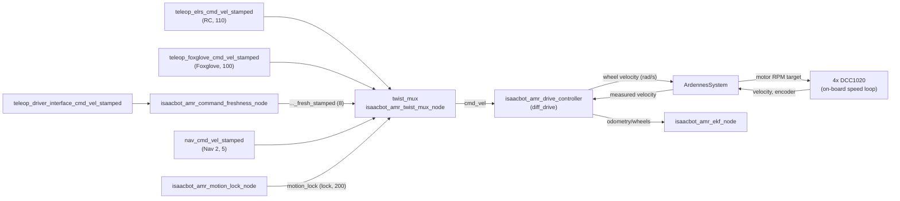

# Drive and control

This page describes how a velocity command becomes wheel motion on the Ardennes: command arbitration, the safety gates in the path, the `ros2_control` controllers, the hardware interface and the on-board wheel speed loop. It also covers the drive limits, odometry and the calibration tools.

ROS names on this page are relative to the robot namespace `isaacbot`. For example, `cmd_vel` is `/isaacbot/cmd_vel`.

## Drive topology



1. **`twist_mux`** (`isaacbot_amr_twist_mux_node`) is the only publisher of `cmd_vel`. The highest-priority fresh input wins.
2. **`isaacbot_amr_motion_lock_node`** closes the mux on any E-Stop or stale safety state. **`isaacbot_amr_command_freshness_node`** drops Driver UI commands that arrive late.
3. **`isaacbot_amr_drive_controller`** (`diff_drive_controller/DiffDriveController`) turns `cmd_vel` into left and right wheel speeds and publishes wheel odometry.
4. **`isaacbot_amr_hardware_interface/ArdennesSystem`** receives the wheel velocity commands directly, converts them to motor-shaft RPM targets for four Phidget DCC1020 motor controllers, and owns the safety PLC link.
5. **Each DCC1020** closes the speed loop on board (trapezoidal motion profile + PID in its `MotorVelocityController` channel).

Until the DCC1020 swap, four host-side `isaacbot_amr_controller/SeededPidController`s sat between `diff_drive` and the hardware. They are no longer spawned (the controller is still built). See [Wheel speed loop](#wheel-speed-loop).

Source: `isaacbot_amr_twist_mux/config/isaacbot_amr_twist_mux.yaml`, `isaacbot_amr_twist_mux/launch/isaacbot_amr_twist_mux.launch.py`, `isaacbot_amr_controller/config/wheel_01_controller.yaml`, `isaacbot_amr_hardware_interface/README.md`.

## Command arbitration (twist_mux)

All inputs are `geometry_msgs/TwistStamped` (`use_stamped: true`). The launch file remaps the mux output `cmd_vel_out` to `cmd_vel`.

| Input | Topic | Priority | Timeout | Source |
|---|---|---:|---:|---|
| `cmd_elrs` | `teleop_elrs_cmd_vel_stamped` | 110 | 0.5 s | ELRS RC teleop (`isaacbot_amr_crsf_teleop`) |
| `joystick` | `teleop_foxglove_cmd_vel_stamped` | 100 | 0.5 s | Foxglove virtual joystick, calibration tools |
| `driver_interface` | `teleop_driver_interface_cmd_vel_fresh_stamped` | 8 | 0.3 s | Driver UI, via `isaacbot_amr_command_freshness_node` |
| `nav` | `nav_cmd_vel_stamped` | 5 | 0.5 s | Nav 2 (orchestrator computer) |

| Lock | Topic | Priority | Timeout | Source |
|---|---|---:|---:|---|
| `motion_lock` | `motion_lock` (`std_msgs/Bool`) | 200 | 0.5 s | `isaacbot_amr_motion_lock_node` |

An input is masked when its priority is below the lock's, so at 200 an active lock stops every source. A stale lock counts as locked. The RC transmitter has the highest input priority, so the operator with line of sight always has the last word. Nav 2 has the lowest, so any teleop source pre-empts autonomy.

The Driver UI, the drive modes and Nav 2 live in other repositories (`isaacbot_amr_drive_interface`, `isaacbot_amr_orchestrator`).

Source: `isaacbot_amr_twist_mux/config/isaacbot_amr_twist_mux.yaml`, `isaacbot_amr_twist_mux/README.md`.

### Motion lock

`isaacbot_amr_motion_lock_node` subscribes to `hardware_interface/safety_status` and `hardware_interface/safety_command_echo` and publishes `motion_lock` at 10 Hz. It is fail-safe closed: the lock is asserted before both topics have arrived, when either is older than `gpio_timeout` (1.0 s), when `link_healthy` is false, or when an enabled stop condition is active.

| Parameter | Value | Meaning |
|---|---|---|
| `publish_frequency` | 10.0 Hz | Republish rate |
| `gpio_timeout` | 1.0 s | Safety topic staleness limit |
| `use_hw_e_stop_user_button` | `true` | Hardware E-Stop button locks |
| `use_sw_e_stop_user_button` | `true` | SW user E-Stop locks |
| `use_sw_e_stop_motor_driver_fault` | `true` | SW motor-driver fault locks |
| `use_sw_e_stop_latch_status` | `true` | Latched relay locks |
| `require_motor_contactor_engaged` | `false` | Contactor open locks (unverified on hardware, off) |

Source: `isaacbot_amr_twist_mux/config/isaacbot_amr_motion_lock.yaml`. See [Safety](../safety.md#motion-gates) for the full gate list.

### Command freshness

The Driver UI's commands cross a websocket, which can hold them during a Wi-Fi stall and deliver them in a burst. `isaacbot_amr_command_freshness_node` tracks the best recent delivery delay (the baseline) and drops any command more than `max_delay` beyond it. Unstamped commands are dropped.

| Parameter | Value |
|---|---|
| `input_topic` | `teleop_driver_interface_cmd_vel_stamped` |
| `output_topic` | `teleop_driver_interface_cmd_vel_fresh_stamped` |
| `max_delay` | 0.3 s |
| `max_clock_drift` | 0.001 s/s |
| `resync_gap` / `resync_time` | 1.0 s / 2.0 s |

It reports a `Command freshness` diagnostic, WARN while it is dropping commands.

Source: `isaacbot_amr_twist_mux/config/isaacbot_amr_command_freshness.yaml`, `isaacbot_amr_twist_mux/README.md`.

## Kinematic limits

`isaacbot_amr_drive_controller` limits linear and angular velocity independently.

| Limit | Value |
|---|---|
| Linear velocity `linear.x` | ±0.95 m/s |
| Linear acceleration / deceleration | 1.4 m/s² (measured with the DCC1000, **TBD** re-measure with the DCC1020) |
| Angular velocity `angular.z` | ±1.5 rad/s |
| Angular acceleration / deceleration | 1.3 rad/s² (measured with the DCC1000, **TBD** re-measure) |
| Jerk limits | 2.0 m/s³ / 2.0 rad/s³ (set 2026-10-25, wheels lifted). Applied only while the acceleration builds. Without them a low-speed command reached the wheels as an instant step |
| `cmd_vel_timeout` | 0.5 s |
| Wheel joint velocity limit (URDF) | 10.958 rad/s |
| DCC1020 target clamp (`max_rpm_motor_speed` 2800 / `gear_ratio` 23.3) | 12.58 rad/s |

Source: `isaacbot_amr_controller/config/wheel_01_controller.yaml`, `isaacbot_amr_description/urdf/common/wheel.urdf.xacro`.

Because the two axes are limited separately, the outer wheel's rim speed can reach v + ω × (effective track) / 2. The config comment gives 0.95 + 1.5 × 0.5102 = 1.715 m/s (10.39 rad/s at r = 0.1651 m), under the URDF joint limit. RC teleop additionally scales stick commands so the outer rim stays under `max_wheel_rim_speed` (1.7 m/s).

`test/test_wheel_geometry.py` checks that the outer wheel reference stays under the URDF joint limit (10.39 ≤ 10.958 rad/s) and under the DCC1020 target clamp (12.58 rad/s). It also checks that `diff_drive` drives the wheel joints directly and that no `SeededPidController` is configured.

!!! warning "Source conflict"
    The effective track width is `wheel_separation` × `wheel_separation_multiplier` = 0.617 × 1.659 = 1.0236 m from `isaacbot_amr_controller/config/wheel_01_controller.yaml`. The comment in the same file says the product is 1.020 m (it assumes a separation of 0.615 m), and `isaacbot_amr_crsf_teleop/config/isaacbot_amr_crsf_teleop.yaml` uses `effective_track_width: 1.0204` (0.62602 × 1.63). The controller uses 0.617 × 1.659.

## Rates

| Component | Rate | Note |
|---|---|---|
| `controller_manager` | 25 Hz | `read()` / `write()` cycle. 25 Hz, not 50: with the DCC1000, 22-24 % of the velocity commands were dropped at 50 Hz (see the `command path` diagnostic). Measure the DCC1020 command latency before raising it |
| `isaacbot_amr_drive_controller` | 25 Hz | Odometry published every update. The speed loop runs on the DCC1020s, not at this rate |
| `isaacbot_amr_imu_broadcaster` | 25 Hz | The manager's rate; the EKF runs at 50 Hz and predicts between samples |
| `isaacbot_amr_joint_state_broadcaster` | 25 Hz | The manager's rate |
| Motor driver state, safety topics | 20 Hz | `driver_states_update_frequency` |
| Velocity feedback (DCC1020 `OnVelocityChange`) | Board minimum data interval, or `motor_data_interval_ms` (**TBD**) | Replaces the DCC1000's 10 Hz encoder counts |
| EKF (`isaacbot_amr_ekf_node`) | 50 Hz | |

Every controller rate must divide the manager's 25 Hz (`isaacbot_amr_controller/test/test_wheel_geometry.py`).

Source: `isaacbot_amr_controller/config/wheel_01_controller.yaml`, `isaacbot_amr_controller/README.md`, `isaacbot_amr_description/urdf/ardennes/ardennes_macro.urdf.xacro`, `isaacbot_amr_localization/config/rel_localization.yaml`.

## Wheel geometry and the separation multiplier

| Parameter | Value |
|---|---|
| `wheels_per_side` | 2 |
| `wheel_separation` | 0.617 m |
| `wheel_radius` (odometry rolling radius) | 0.1651 m |
| `wheel_separation_multiplier` | 1.659 |
| `left_wheel_radius_multiplier` / `right_wheel_radius_multiplier` | 1.0 / 1.0 |

Source: `isaacbot_amr_controller/config/wheel_01_controller.yaml`, `isaacbot_amr_description/config/wheel_01.yaml` (must match, enforced by `test/test_wheel_geometry.py`).

**Why the multiplier exists.** The Ardennes is a four-wheel skid-steer platform. When it turns, the wheels slip sideways, so the body turns more slowly than an ideal two-wheel differential drive with the same track would. `diff_drive_controller` models the ideal case. `wheel_separation_multiplier` scales the track to an effective value so the wheel speeds commanded for a turn, and the yaw rate the odometry reports, match the real rotation. The value depends on the surface. Measure it with `wheel_odom_calibration` (below) on the surface the isaacbot mostly drives on.

## Odometry

`isaacbot_amr_drive_controller` publishes wheel odometry on `odometry/wheels` (frame `odom` to `base_footprint`) and **does not publish TF** (`enable_odom_tf: false`). The EKF in `isaacbot_amr_localization` (`isaacbot_amr_ekf_node`, `robot_localization`) fuses the wheel body velocities (vx, vy) with the IMU yaw rate, publishes the `odom` → `base_footprint` transform and the filtered odometry on `odom`.

| Item | Value |
|---|---|
| Wheel odometry topic | `odometry/wheels` |
| Wheel odometry TF | off |
| EKF output topic | `odom` (remapped from `odometry/filtered`) |
| EKF TF | `odom` → `base_footprint` (`publish_tf: true`) |
| EKF inputs | `odometry/wheels` (vx, vy), `imu/data` (yaw rate) |

Source: `isaacbot_amr_controller/config/wheel_01_controller.yaml`, `isaacbot_amr_localization/config/rel_localization.yaml`, `isaacbot_amr_localization/launch/isaacbot_amr_localization.launch.py`.

## Hardware interface

`ArdennesSystem` (`hardware_interface::SystemInterface`) exports a `velocity` command and `position`, `velocity` and `effort` states per wheel joint. Key URDF parameters for the drive:

| Parameter | Value | Meaning |
|---|---|---|
| `motor_current_limit` | 15.0 A | Per motor. ASSUMPTION carried over from the DCC1000; Phidgets suggests ~1.1× rated ≈ 11.5 A |
| `max_rpm_motor_speed` | 2800 rpm | Clamp on the motor RPM target |
| `gear_ratio` | 23.3 | |
| `encoder_resolution` | 1024 | Also sets the board's rescale factor |
| `raw_current_to_amps_scale` | 0.01 | Current is reported in 10 mA units |
| `motor_failsafe_timeout_ms` | 500 ms | DCC1020 hardware watchdog. Disengages the motor if commands stop. |
| `motor_failsafe_braking_enabled` | `true` (default) | Brake (not coast) on a failsafe trip |
| `velocity_kp` / `velocity_ki` / `velocity_kd`, `velocity_deadband_rpm` | 0.0017 / 0.0341 / 0 / 5 RPM | Tuned 2026-10-25, wheels lifted (see the URDF comment for the step results); not yet checked under load |
| `motor_inductance` | 0.000575 H | Measured by the boards, mean of hub ports 0, 1, 5. `motor_inductance` is set when the channel attaches, which skips the motor characterization (the beeps) at every open. Without it the board characterizes the motor at open, which fails with a latched `motor_setup_fault` (error 0x1011) while the motor contactor is open; `sw_e_stop_latch_reset` then re-opens the channel |
| `motor_acceleration_rpm_s` | 1890 RPM/s | = 1.4 m/s² at the wheel, diff_drive's linear limit: smooths diff_drive's 25 Hz command steps. Caps each wheel on its own, so the outer wheel in an accelerating turn is limited to 1.4 m/s² (**TBD** check on the ground) |
| `motor_surge_current_limit`, `motor_stall_velocity_rpm`, `motor_failsafe_current_limit`, `motor_data_interval_ms` | not set (**TBD**) | Optional on-board loop settings. Absent = board default, logged at configure. |
| `driver_comm_timeout_ms` | 300 ms | Telemetry age that counts as a communication error |

`motor_acceleration` (DCC1000 duty/s) and `motor_supply_voltage` (DCC1000 current-regulator gain) were removed. `on_init()` rejects a URDF that still sets them.

**Command path.** `write()` converts each wheel command to a motor-shaft RPM target (rad/s × `gear_ratio` × 60 / 2π), clamps it to ±`max_rpm_motor_speed` and hands it to the motor driver. The DCC1020 velocity controller has no asynchronous setter, so `sendCmdVel()` only posts the newest target, lock-free, into a per-motor mailbox. A per-motor command worker thread makes the blocking `PhidgetMotorVelocityController_setTargetVelocity` call. A newer target that arrives while a call is in flight replaces the waiting one; the `command path` diagnostic counts these as `dropped_pending`. `scripts/check_rt_path_purity.sh` forbids the blocking setters on the RT path.

**Feedback.** Velocity comes from the board's `OnVelocityChange` events, joint position from the Encoder channel. If the Encoder channel cannot be opened next to the velocity controller, the position is integrated from the velocity instead (bench check still open).

**Failsafe and faults.** At activation the driver enables and feeds the failsafe, then engages the controller (`setEngaged(true)`); the board does nothing until engaged. Every target sent feeds the failsafe. On any E-Stop or latched fault, `write()` keeps sending **zero** targets so the watchdog stays fed, and a stalled RT loop still trips it. Board error events map to `fault_flag.*` entries in the driver diagnostics:

| Flag | Board event | Latched |
|---|---|---|
| `emergency_stop` | DCC1020 E-Stop input open (`EEPHIDGET_ESTOP`) | yes |
| `over_temperature` | Thermal derating / shutdown | no |
| `over_current` | Over-current | no |
| `over_voltage` | Over-voltage, energy dump (≥ 42 V) | yes |
| `motor_stall` | Dangerous stall | yes |
| `bad_power` | Bad supply | no |

Transient flags clear on the board's "Error Cleared" event. A tripped watchdog, an E-Stop, a stall or an energy dump is latched and is cleared only by `hardware_interface/sw_e_stop_latch_reset`, which re-opens the channel. The `isaacbot_amr_msgs/FaultFlag` message still carries only `emergency_stop` and `motor_setup_fault`; the new bits are visible in diagnostics only.

Source: `isaacbot_amr_description/urdf/ardennes/ardennes_macro.urdf.xacro`, `isaacbot_amr_hardware_interface/README.md`.

## Wheel speed loop

Each DCC1020 runs the wheel speed loop on board: its `MotorVelocityController` channel applies a trapezoidal motion profile (`motor_acceleration_rpm_s`) and a PID (`velocity_kp`, `velocity_ki`, `velocity_kd`, `velocity_deadband_rpm`). The driver rescales the controller to motor-shaft RPM with `rescaleFactor = 60 / (4 × encoder_resolution)`, so the targets, gains and limits are all in motor RPM.

The gains are **TBD**: no value is set in the URDF yet, so the boards run with their own defaults. At configure the driver logs the values each board actually uses, one line per motor:

```text
Motor hub port N (serial S): Kp=... (board default) Ki=... (board default) Kd=... (board default) dead band=... RPM, acceleration=... RPM/s, ...
```

To tune, start from those values, set the parameters in `isaacbot_amr_description/urdf/ardennes/ardennes_macro.urdf.xacro`, and check with `wheel_step_response` (below). Then re-measure the `diff_drive` / Nav 2 acceleration limits, which were measured with the DCC1000.

!!! note "Host wheel PIDs (historical)"
    With the DCC1000, which took only a duty cycle and reported the encoder at 10 Hz, the loop was closed on the host by four `isaacbot_amr_controller/SeededPidController`s chained under `diff_drive`, with a feed-forward of the rad/s-scaled duty and a model-reference integral. Since the DCC1020 swap they are no longer spawned. The controller is still built; its design and ground-tune history are in the [isaacbot_amr_controller README](https://github.com/isaacbotsrl/isaacbot_amr_ros/blob/main/isaacbot_amr_controller/README.md) and the [wheel PID tuning notes](https://github.com/isaacbotsrl/isaacbot_amr_ros/blob/main/isaacbot_amr_controller/docs/wheel_pid_tuning_notes.md).

Source: `isaacbot_amr_controller/config/wheel_01_controller.yaml`, `isaacbot_amr_description/urdf/ardennes/ardennes_macro.urdf.xacro`, `isaacbot_amr_hardware_interface/src/isaacbot_amr_driver/phidget_driver/phidget_motor_driver.cpp`.

## Calibration tools

Both tools publish on the Foxglove input `teleop_foxglove_cmd_vel_stamped` (priority 100), so the motion lock still gates them. They print their plan and only move the isaacbot with `-p enable_motion:=true`. Results go to `~/isaacbot_amr_calibration/<tool>_<timestamp>/` (`summary.yaml` and raw samples).

!!! danger
    These tools drive the isaacbot. Lift the wheels for the first run, keep the area clear, and keep the hardware E-Stop in reach.

Run them in this order:

1. **Wheel-speed loop** (`wheel_step_response`). Steps the linear speed (default 0.2, 0.4, 0.6, 0.8, −0.4 m/s) and the angular speed (0.5, 1.0, −1.0 rad/s), and reports overshoot, steady-state error and dead time per wheel. It also reports body acceleration limits derived from the largest wheel acceleration (`margin` 0.8). Target: overshoot under 10 % and steady-state error under 3 %. Run with the wheels lifted first, then on the ground.

    ```bash
    ros2 run isaacbot_amr_controller wheel_step_response --ros-args -r __ns:=/isaacbot -p enable_motion:=true
    ```

2. **Acceleration limits.** Use the limits reported in step 1 to set `linear.x` / `angular.z` acceleration in `wheel_01_controller.yaml`.

3. **Skid-steer calibration** (`wheel_odom_calibration`). `mode:=spin` spins in place at several rates (default ±0.3, ±0.6, ±1.0 rad/s), compares the rotation the wheel speeds explain with the IMU gyro and reports `wheel_separation_multiplier`. The IMU is mounted upside down, so the tool negates the gyro yaw rate (`imu_yaw_sign` −1). If every spin segment is rejected while the isaacbot clearly turned, re-run with `-p imu_yaw_sign:=1`. `mode:=straight` drives until wheel odometry reads `distance`; tape-measure the real distance `d` and set both wheel radius multipliers to `d / distance`.

    ```bash
    ros2 run isaacbot_amr_controller wheel_odom_calibration --ros-args -r __ns:=/isaacbot -p mode:=spin -p enable_motion:=true
    ros2 run isaacbot_amr_controller wheel_odom_calibration --ros-args -r __ns:=/isaacbot -p mode:=straight -p distance:=5.0 -p enable_motion:=true
    ```

Both tools default to the controller config's geometry: `wheel_separation` 0.617, and in `wheel_step_response` also `wheel_separation_multiplier` 1.659. If you change the config, pass the new values as parameters (for example `-p wheel_separation:=0.617`).

Source: `isaacbot_amr_controller/README.md`, `isaacbot_amr_controller/isaacbot_amr_controller/wheel_step_response.py`, `isaacbot_amr_controller/isaacbot_amr_controller/wheel_odom_calibration.py`, `isaacbot_amr_controller/isaacbot_amr_controller/drive_session.py`.

## Further reading

- [isaacbot_amr_twist_mux README](https://github.com/isaacbotsrl/isaacbot_amr_ros/blob/main/isaacbot_amr_twist_mux/README.md)
- [isaacbot_amr_hardware_interface README](https://github.com/isaacbotsrl/isaacbot_amr_ros/blob/main/isaacbot_amr_hardware_interface/README.md)
- [isaacbot_amr_localization README](https://github.com/isaacbotsrl/isaacbot_amr_ros/blob/main/isaacbot_amr_localization/README.md)
